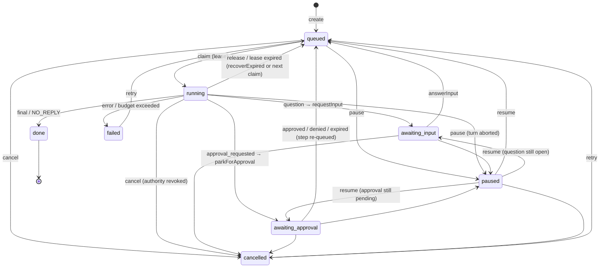

# @psyche/tasks

**Owner:** S04 (`prompts/s04-tasks-scheduler.md`). Feature ids: D1–D3, D6, D7 in [docs/03-feature-spec.md](../../docs/03-feature-spec.md).

Durable background work: tasks that outlive the turn that created them, survive worker crashes, Gateway restarts and laptop sleep, park on questions and approvals, and keep an Activity log.

## Public API (`src/index.ts`)

- `SqliteTaskEngine` (`implements TaskEngine`): `new SqliteTaskEngine({ db: PsycheDb, clock, newId?, nextStateVersion?, level3? })`. Contract methods plus:
  - `create(input & { mode?: "attended" | "unattended", budget? })`, `getRecord(id)` (run mode, budget, what it waits on, pending resume items), `listPage({ status?, threadId?, cursor?, limit? })`, `actionsPage(id, { cursor?, limit? })`, `inputRequests({ taskId?, status? })`.
  - Parking: `requestInput(id, questions, { id? })` (adopts the loop's input-request id), `parkForApproval(id, { approvalId, stepId? })`, `resolveApproval(id, approval)`, `rebindApproval(id, newApprovalId)`, `parkedOnApprovals()`.
  - Recovery: `recoverExpired()` (boot / wake sweep), `takeResume(lease)`, `reconcile(id, stepId, { status, receiptId?, note? })`, `retry(id, { fromStepId? })`.
  - `attachResources(id, { browserSessionId?, sandboxId? })` (D7), `updatePlan(id, { plan?, checklist? })` (D5).
  - `subscribe(listener)`: `{ event: "task.updated" | "task.action", payload, stateVersion }` after every committed mutation.
- `TaskWorkerPool`: `new TaskWorkerPool({ engine, loop, clock, timers?, owner?, concurrency?, leaseMs?, renewEveryMs?, pollMs?, broker?, notifier?, tools? | isReplaySafe?, permissionModeFor?, defaultBudget? })`; `start()`, `stop()`, `poke()`, `runOnce({ owner?, taskId? })`, `watchApproval(taskId, approvalId)`, `onApprovalsReissued(issued)`.
- `createTaskHandlers({ engine, pool?, broker? })` → `tasks.list | get | pause | resume | cancel | retry | actions`, typed from `TasksMethods` (S01 mounts them after validating params and scopes).
- `buildTurnInput(record, resume, checkpoints)`: the text the next turn starts from.

## Task state machine

Checkpoints (one per step; the worker uses the tool call id) are `pending | running | done | failed | uncertain`. When work stops with a step `running` (lease expired, pause, cancel), a `replaySafe` step goes back to `pending` (or `failed` on cancel) and an unsafe one becomes `uncertain`. Nothing ever moves a step out of `uncertain` except `reconcile` (the owner or a receipt says what happened). The next turn is told which steps are uncertain and not to repeat them.

## How it maps to the docs

- Leases (architecture §4.5): `lease_owner`, `lease_until`, plus `lease_token`, which changes on every claim; `renew` / `release` / `takeResume` with a stale token fail with `conflict`. Every mutation is one `BEGIN IMMEDIATE` transaction, so two connections to the same file cannot both win a claim (tested with two worker threads). The worker re-checks its lease before it writes a turn's result, so a worker that wakes after its lease expired writes nothing.
- Cancellation (§4.5): `cancel` is terminal; the pool sees the `task.updated` event, aborts the turn's `AbortSignal`, calls `AgentLoop.cancel(runId)` and `PermissionBroker.revokeRunAuthority(runId)` at once. A request already dispatched may still report back; its `tool_call` result still updates the step's checkpoint (reconciled through its receipt).
- Parking (§4.5, security §3.7): input requests never time out. An approval is awaited with `PermissionBroker.awaitDecision`; approval or denial re-queues the task with the decision in the resume queue; expiry puts the step back to `pending` and re-queues the task so the next turn asks again; a restart invalidation (`gateway_restart`) leaves the task parked until `onApprovalsReissued` rebinds it to the fresh request.
- Activity log (D4): level 1 is one line of at most 200 characters; level 2 is `{tool, target?, outcome?}`; level 3 is a ref, written through an injected `Level3Store` (the Library) when a raw payload is given. `tasks.actions` returns levels 1–2 and the ref.
- Unattended runs (§4.3): tasks created with `mode: "unattended"` (automations, heartbeat) start their turns with `mode: "unattended"`; `NO_REPLY` settles the task `done` with `outcome.result = "no_reply"` and no notification.
- Budgets: `maxSteps` (tool calls), `maxTokens` (input + output), `maxWallMs` per turn; exceeding one cancels the turn and fails the task with the reason.

Data model deviations (all in S04's own `tasks` table, `packages/db/migrations/202610191200_tasks_init.sql`): `lease_token`, `run_mode`, `budget`, `resume`, `awaiting`, `taint`; `task_checkpoints.updated_at`. `input_requests.question` holds the array of questions.

## What is stubbed

- Checkpoints are derived from the loop's `tool_call` events; replay safety comes from the tool registry's side-effect class (`none` / `read` = safe). Receipt ids are not on `tool_call` events yet, so `checkpoint.receiptId` is only set by `reconcile`.
- Notifications: `input_needed`, `task_done`, `task_failed` through `Notifier`; approval cards are delivered by S05.
- Evaluator hook before `done` (M2, with S02's C7) and heartbeat token accounting are not implemented.
